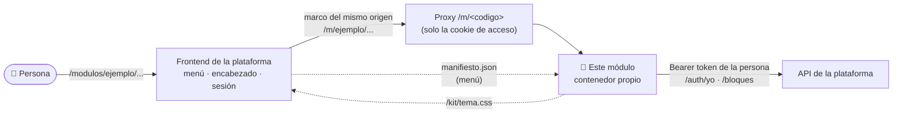

<div align="center">

# 🧩 ejemplo-modulo-scheduling

**Módulo externo de ejemplo para [DISC Scheduling](https://github.com/Capstone-2026-DISC)**
_la plataforma de programación académica del Departamento de Ingeniería de Sistemas y Computación (UCN)_

[](https://nextjs.org)
[](https://react.dev)
[](https://nodejs.org)
[](Dockerfile)
[](#-qué-hace)
[](https://github.com/Capstone-2026-DISC/ejemplo-modulo-scheduling/wiki)

Una plantilla para que cada grupo de Proyecto Integrador agregue **sus propias pantallas** a la plataforma<br>
**sin tocar la repo de la plataforma**: su módulo es un servicio aparte, con su repo y su imagen.

[Cómo funciona](https://github.com/Capstone-2026-DISC/ejemplo-modulo-scheduling/wiki/Como-funciona) · [Crear su módulo](https://github.com/Capstone-2026-DISC/ejemplo-modulo-scheduling/wiki/Crear-su-modulo) · [Encenderlo en la plataforma](https://github.com/Capstone-2026-DISC/ejemplo-modulo-scheduling/wiki/Encenderlo-en-la-plataforma) · [Preguntas frecuentes](https://github.com/Capstone-2026-DISC/ejemplo-modulo-scheduling/wiki/Preguntas-frecuentes)

</div>

> [!NOTE]
> **Esto es una propuesta.** Muestra cómo creemos que los módulos de los grupos pueden sumarse a la plataforma. Los
> acuerdos (qué datos se comparten, cómo, plazos y responsabilidades) les llegarán en un documento formal aparte, y este
> ejemplo se ajustará a lo que conversemos con ustedes.

---

## ✨ Qué hace

Es un módulo mínimo, de **solo lectura**, con textos de relleno, que muestra todo lo que un módulo puede hacer:

| Página | Qué muestra | Permiso |
|---|---|---|
| **Inicio** `/` | Lorem ipsum y la sesión de quien mira (nombre, rol, departamento, permisos), leída de la plataforma | ninguno |
| **Menú de la plataforma** `/menu` | Las secciones e ítems del menú de la plataforma (`/kit/menu.json`) y dónde cae cada ítem de este módulo | ninguno |
| **Datos** `/datos` | Un dato sin importancia: los bloques horarios A a G del catálogo. En el menú va en PERIODO, después de «Datos maestros» | `catalogo.ver` |
| **Restringida** `/restringida` | Lorem ipsum, solo para administradores; la página vuelve a comprobar el permiso. En el menú va en su propia sección, PRUEBA | `usuarios.gestionar` |
| `/manifiesto.json` | El menú que la plataforma muestra | — |
| `/salud` | El chequeo de salud del contenedor | — |

## 🗺️ Cómo se integra



1. El **menú** de la plataforma suma los ítems del manifiesto del módulo, filtrados por los permisos de cada persona, en
   la sección y la posición que elija cada ítem (ver [Ubicar los ítems en el menú](#-ubicar-los-ítems-en-el-menú)).
2. Al abrir uno, la plataforma pone su **encabezado** y muestra el módulo debajo, en un marco del mismo dominio.
3. El módulo **no tiene login**: recibe la cookie de sesión y consulta la API de la plataforma con el token de la persona.
4. Toma los **colores** del kit de la plataforma (`/kit/tema.css`) y avisa su alto para que no haya doble barra de desplazamiento.

## 🧭 Ubicar los ítems en el menú

En `src/lib/manifiesto.js`, cada ítem puede elegir dónde aparece:

| Campo | Qué hace |
|---|---|
| `grupo` del manifiesto | La sección por defecto de los ítems. Si no existe en la plataforma, se crea una nueva antes de AJUSTES. |
| `grupo` de un ítem | Lo manda a otra sección: una de la plataforma (`PERIODO`, `HORARIOS`, `COSTOS`...) o una nueva. Un módulo puede crear varias secciones propias (este crea EJEMPLO y PRUEBA). No importan mayúsculas ni tildes. |
| `despues_de` | El href de un ítem de esa sección (por ejemplo `"/datos-maestros"`): el del módulo queda justo después. Si falta o no existe, va al final. |

La página **Menú de la plataforma** lista las secciones e ítems vigentes (`/kit/menu.json`) y marca dónde quedan los de
este módulo. El administrador de la plataforma puede juntar todos los ítems de un módulo en la sección **MÓDULOS** desde
Ajustes avanzados, sin importar lo que diga el manifiesto.

Dentro del panel, el módulo no dibuja un menú lateral propio: el menú es el de la plataforma. Si su módulo tiene uno para
usarlo por separado, ocúltelo cuando `window.self !== window.top`. Tampoco repite el Inicio ni administra cuentas o
permisos: eso es de la plataforma.

## 🚀 Empezar

```bash
npm install
API_URL=http://127.0.0.1:8000 npm run dev    # http://127.0.0.1:3100/m/ejemplo
```

Fuera de la plataforma no hay sesión ni kit: las páginas lo dicen y usan colores de respaldo. Para verlo de verdad se
enciende desde la plataforma ([Encenderlo en la plataforma](https://github.com/Capstone-2026-DISC/ejemplo-modulo-scheduling/wiki/Encenderlo-en-la-plataforma)).

### 🐳 Imagen

```bash
docker build --build-arg RUTA_BASE=/m/ejemplo -t ejemplo-modulo-scheduling .
```

`RUTA_BASE` debe coincidir con el código del módulo en la plataforma (`/m/<codigo>`).

## 🧱 Estructura

```
src/
├── app/
│   ├── layout.js               # sin menú propio: lo pone la plataforma; enlaza /kit/tema.css
│   ├── page.js                 # Inicio: lorem ipsum + la sesión
│   ├── menu/page.js            # el menú de la plataforma y dónde caen los ítems del módulo
│   ├── datos/page.js           # dato de solo lectura (catalogo.ver)
│   ├── restringida/page.js     # página con permiso (usuarios.gestionar)
│   ├── manifiesto.json/route.js
│   └── salud/route.js
├── components/altura_incrustada.js   # avisa el alto al marco de la plataforma
├── components/menu_plataforma.js     # lee /kit/menu.json
├── lib/
│   ├── plataforma.js           # sesión, permisos y lecturas a la API (todo en un lugar)
│   └── manifiesto.js           # el menú del módulo
└── styles/modulo.module.css    # usa las variables del kit (--c-*, --radius-*)
```

## 🧭 Para crear el módulo de su grupo

- [ ] **Use this template** en GitHub y nómbrela según su módulo.
- [ ] Cambie `codigo`, `nombre` e `items` en `src/lib/manifiesto.js`, y `RUTA_BASE` (`/m/<codigo>`).
- [ ] Lea siempre con el token de la persona (`src/lib/plataforma.js`); nada de login ni base de datos propios para lo que ya tiene la plataforma.
- [ ] Compruebe el permiso de cada página **en el servidor**, aunque el menú ya la oculte.
- [ ] Use las variables del kit para los colores; avise el alto si su página crece.
- [ ] Publique una **etiqueta** (`v1.0.0`) por entrega: la plataforma construye desde ella.

## 📏 Estándar

Español de Chile en textos, comentarios y nombres del dominio; archivos y funciones en `snake_case`, componentes en
`PascalCase`; versiones exactas en `package.json`; commits en inglés con Conventional Commits. Es el estándar de
programación de DISC Scheduling.

---

<div align="center">
<sub>Capstone 2026 · DISC UCN · más detalles en la <a href="https://github.com/Capstone-2026-DISC/ejemplo-modulo-scheduling/wiki">wiki</a></sub>
</div>
